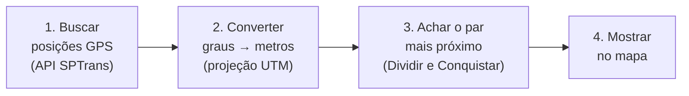

# TwoBus

Número da Lista: 33<br>
Conteúdo da Disciplina: Dividir e Conquistar — Par de Pontos Mais Próximos<br>

## Alunos

| Matrícula | Aluno |
| :-- | :-- |
| 22/1022266 | Eric Silveira Gomes |

---

## Sobre

**Pergunta:** entre todos os ônibus de uma linha de São Paulo circulando agora, quais dois estão mais perto um do outro?

O **TwoBus** responde a essa pergunta em tempo real. Ele busca a posição GPS dos ônibus na **API Olho Vivo da SPTrans**, trata cada ônibus como um **ponto no mapa** e encontra o par mais próximo usando um algoritmo de **Dividir e Conquistar**.

Para provar que o algoritmo acerta, o app também resolve o mesmo problema do jeito mais simples (**força bruta**, comparando todos com todos) e confere se os dois chegam à mesma resposta.

Sem token da SPTrans, tudo funciona com dados simulados (**Modo Demonstração**).

> ⚠️ Dois ônibus próximos **não** significam necessariamente um problema na operação (eles podem estar no terminal, em pistas opostas etc.). O TwoBus é um projeto para estudar algoritmos, não uma ferramenta de fiscalização.

---

## Como funciona, em 4 passos



1. **Buscar:** o usuário escolhe uma linha (ex.: `8000`) e o sentido; o app pede à SPTrans a latitude e a longitude de cada ônibus.
2. **Converter:** latitude e longitude são ângulos, não metros. Por isso o app converte cada posição para um plano em metros (sistema **UTM 23S**, o usado para São Paulo). Assim a distância vira a fórmula da escola: $d = \sqrt{(x_1-x_2)^2 + (y_1-y_2)^2}$.
3. **Calcular:** o algoritmo de Dividir e Conquistar encontra o par mais próximo.
4. **Mostrar:** o par aparece em destaque no mapa, ligado por uma linha tracejada com a distância.

---

## O algoritmo explicado

### O jeito óbvio: força bruta

Comparar cada ônibus com todos os outros. Com $n$ pontos são $\frac{n(n-1)}{2}$ comparações:

* 10 pontos → 45 comparações
* 1.000 pontos → ~500 mil comparações
* 5.000 pontos → ~12,5 milhões de comparações

Funciona, mas o trabalho cresce com o **quadrado** de $n$: $O(n^2)$.

### O jeito inteligente: Dividir e Conquistar

A ideia é a mesma de procurar uma palavra no dicionário: em vez de olhar tudo, **parte o problema ao meio** e resolve as partes menores.

1. **Dividir:** ordena os pontos da esquerda para a direita e traça uma reta vertical no meio, separando-os em duas metades.
2. **Conquistar:** resolve cada metade sozinha (repetindo a mesma ideia até sobrarem 2 ou 3 pontos, que se comparam diretamente). Cada metade devolve sua menor distância; a menor das duas é chamada de **δ (delta)**.
3. **Combinar:** falta um caso: o par mais próximo pode ter **um ponto de cada lado** da reta. Mas esse par só pode existir **perto da reta**, numa faixa de largura δ para cada lado. Qualquer ponto mais longe que isso já está a mais de δ do outro lado e não tem como ganhar.

O truque que torna tudo rápido: dentro dessa faixa, ordenando os pontos de baixo para cima, **cada ponto só precisa ser comparado com, no máximo, os 7 seguintes**. Pontos mais acima já estão longe demais. Então a etapa de combinar custa pouco.

### Exemplo resolvido (os 7 pontos da demonstração)

| Ponto | A | B | C | D | E | F | G |
| :-- | --: | --: | --: | --: | --: | --: | --: |
| x | 1,0 | 2,5 | 5,0 | 6,2 | 8,0 | 9,5 | 12,0 |
| y | 10,0 | 2,0 | 6,0 | 6,8 | 1,5 | 11,0 | 5,0 |

1. **Dividir:** os pontos já estão ordenados por x. A reta passa entre **C** e **D**:
   esquerda = {A, B, C} e direita = {D, E, F, G}.
2. **Conquistar a esquerda:** o menor par é **B–C ≈ 4,72**.
3. **Conquistar a direita:** o menor par é **E–G ≈ 5,32**.
4. **δ = min(4,72; 5,32) = 4,72.** Até aqui, o campeão é B–C.
5. **Combinar:** olhamos só a faixa de largura 4,72 em volta da reta. Lá estão C e D, um de cada lado: **C–D ≈ 1,44**, que é menor que δ!
6. **Resposta: C–D, distância ≈ 1,44.**

Esse é exatamente o caso que mostra **por que a etapa de combinar é necessária**: se olhássemos só as duas metades separadas, a resposta (B–C) estaria errada.

Nesse exemplo, a força bruta faz **21** comparações e Dividir e Conquistar faz **14**. Com mais pontos a diferença explode (tabela abaixo).

### Por que é mais rápido?

A cada nível o problema é cortado ao meio, e combinar as metades custa um trabalho proporcional a $n$:

$$T(n) = 2\,T(n/2) + O(n) \quad\Rightarrow\quad T(n) = O(n \log n)$$

Medido no próprio projeto (pontos aleatórios em uma área de 10 km × 10 km):

| Pontos | Força bruta | Dividir e Conquistar | Quantas vezes mais rápido |
| --: | --: | --: | --: |
| 100 | 4.950 comparações · 0,8 ms | 133 comparações · 0,4 ms | ≈ 2× |
| 1.000 | 499.500 comparações · 94 ms | 1.131 comparações · 7 ms | ≈ 14× |
| 5.000 | 12,5 milhões de comparações · 2,2 s | 6.479 comparações · 40 ms | ≈ 56× |

> Curiosidade: uma linha de ônibus costuma ter poucos veículos (5 a 30). Com tão poucos pontos a força bruta pode até ser mais rápida, porque é mais simples. A vantagem do Dividir e Conquistar aparece quando $n$ cresce, como mostra a tela **Qual é mais rápido?**.

---

## As telas do app

| Tela | O que mostra |
| :-- | :-- |
| 🏠 **Início** | O problema em uma frase e a diferença entre os dois algoritmos (499.500 × 1.131 comparações). |
| 🧑‍🏫 **1 · Como funciona** | O algoritmo em 6 passos sobre os 7 pontos: dividir, resolver cada lado, olhar a faixa central e achar C–D. |
| 🗺️ **2 · Ônibus ao vivo** | Escolha uma linha e veja no mapa os dois ônibus mais próximos agora, com a distância em metros. |
| ⚡ **3 · Qual é mais rápido?** | Uma "corrida" entre os dois algoritmos e o gráfico de como o trabalho cresce com o número de pontos. |

Na barra lateral escolhe-se entre dados **Reais** (SPTrans) ou **Simulados**. Os ajustes finos ficam em **Ajustes avançados**.

### Roteiro para 5 minutos

1. **Início** (30 s): apresente a pergunta e os dois números grandes.
2. **Como funciona** (2 min): clique em **Avançar** nos 6 passos; o passo 6 mostra por que combinar é necessário.
3. **Ônibus ao vivo** (1 min): busque a linha `8000` e clique em **Buscar ônibus agora**.
4. **Qual é mais rápido?** (1 min): compare com 1.000 ou 5.000 pontos e mostre o gráfico.

---

## Vídeo de Apresentação

<div align="center">
  <a href="https://youtu.be/edKz66xoZY8">
    
  </a>
  <br>
  <a href="https://youtu.be/edKz66xoZY8">🎥 <b>Assistir à Apresentação no YouTube (https://youtu.be/edKz66xoZY8)</b></a>
</div>

---

## Instalação e Execução

**Linguagem:** Python 3.12+<br>
**Interface:** Streamlit (web), com mapas Folium e gráficos Plotly<br>

### 1. Instalar

```bash
python3 -m venv .venv
source .venv/bin/activate
pip install -r requirements.txt
```

### 2. Configurar a SPTrans (opcional)

```bash
cp .env.example .env
```

No `.env`, preencha `SPTRANS_API_TOKEN` com a chave gerada em **Meus Aplicativos** no [portal de desenvolvedores da SPTrans](https://www.sptrans.com.br/desenvolvedores/api-do-olho-vivo-guia-de-referencia/). `SPTRANS_BASE_URL` já vem com o endereço oficial. O `.env` não vai para o Git: **não compartilhe seu token**.

Sem token, o app abre direto no Modo Demonstração.

### 3. Executar

```bash
streamlit run app.py
```

Na barra lateral, **Testar** confere se o token funciona e **Recarregar** relê o `.env` caso você troque a chave.

### 4. Rodar os testes

```bash
pytest
```

São 367 testes automatizados. Eles não acessam a internet: as respostas da SPTrans são simuladas.

---

## Estrutura do Repositório

```text
.
├── app.py                  # Ponto de entrada: menu e barra lateral
├── pages/                  # As telas do app
├── src/
│   ├── algorithms/         # ⭐ Força bruta e Dividir e Conquistar
│   ├── api/                # Conversa com a API da SPTrans
│   ├── geo/                # Conversão graus → metros (UTM 23S)
│   ├── services/           # Análises, medições e dados simulados
│   ├── storage/            # Banco SQLite com as consultas salvas
│   └── ui/                 # Visual: tema, mapa e estado da tela
├── data/sample_7_points.csv  # Os 7 pontos do exemplo
├── tests/                  # Testes automatizados
└── requirements.txt
```

O coração do trabalho está em [src/algorithms/closest_pair.py](src/algorithms/closest_pair.py) (Dividir e Conquistar) e [src/algorithms/brute_force.py](src/algorithms/brute_force.py) (força bruta).

---

## Decisões de Projeto

1. **Converter para metros antes de calcular:** medir distância direto em graus de latitude/longitude daria resultados distorcidos. A conversão para UTM resolve isso, e os testes conferem o resultado com a distância real sobre o globo.
2. **Ordenar uma vez só:** os pontos são ordenados por x e por y no início; depois cada divisão só reparte as listas já ordenadas. Reordenar a cada passo deixaria o algoritmo mais lento.
3. **Força bruta como "gabarito":** toda consulta roda os dois algoritmos e compara as respostas. Se divergirem, a tela avisa.
4. **A demonstração usa o algoritmo de verdade:** os passos mostrados na tela são gravados pela própria execução do algoritmo, não por uma animação separada.
5. **Medições justas:** os dois algoritmos recebem os mesmos pontos, há uma rodada de aquecimento descartada e o tempo de gerar os pontos não entra na conta.
6. **Real e simulado nunca se misturam:** ônibus simulados têm prefixo `SIM-` e cada consulta salva guarda sua origem.
7. **Segredos fora da tela:** o token da SPTrans não aparece na interface, nos logs nem nas mensagens de erro.

### Limites

A distância mostrada é **em linha reta**, não o caminho pelas ruas. Ela não diz se os ônibus estão no mesmo sentido da via nem se há atraso no serviço. Posições muito antigas são descartadas (padrão: mais de 3 minutos).

---

## Referências

* SPTrans. [API Olho Vivo: documentação](https://www.sptrans.com.br/desenvolvedores/api-do-olho-vivo-guia-de-referencia/documentacao-api/).
* Cormen, Leiserson, Rivest e Stein. *Introduction to Algorithms*, seção *Finding the closest pair of points*.
* Kleinberg e Tardos. *Algorithm Design*, cap. 5: *Divide and Conquer*.
* [EPSG:31983: SIRGAS 2000 / UTM zona 23S](https://epsg.io/31983).
